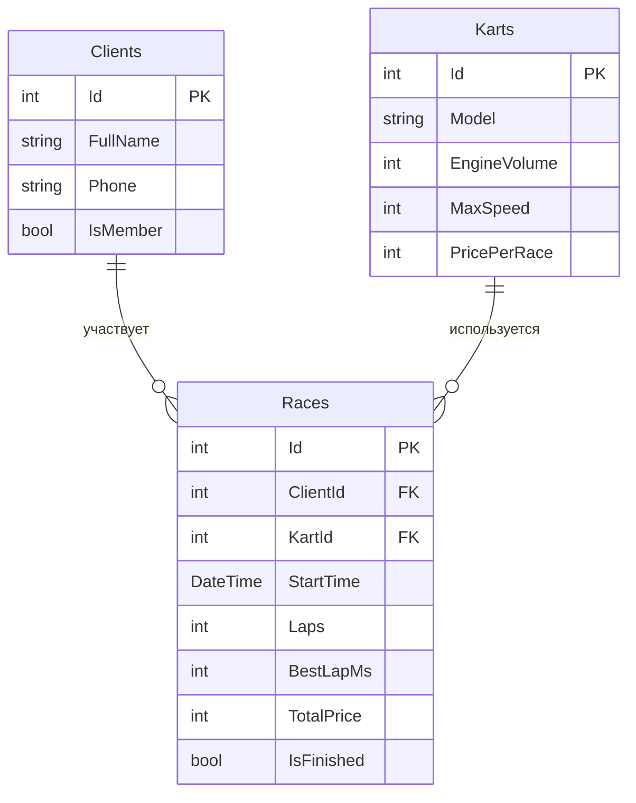

# Апекс - картинг-центр

Приложение для картинг-центра: клиент записывается на заезд, а сотрудник выдаёт карт и фиксирует результат.

## Автор

Литвиненко Кирилл, группа РПО-24/1

## О проекте

**Тема:** Прокат.  
**Заведение:** картинг-центр Апекс.

Апекс - крытый картинг-центр с асфальтовой трассой на 500 метров, где посетители берут напрокат карты и гоняют на время. В центре есть карты трёх классов - детские, любительские и спортивные - с разным объёмом двигателя и максимальной скоростью, поэтому покататься может и новичок, и опытный гонщик. Приложением пользуется сотрудник на ресепшене: он записывает клиента, подбирает подходящий карт и заносит результат заезда - число кругов и лучшее время круга. От других картинг-центров Апекс отличается тем, что ведёт статистику по каждому клиенту: видно, на каких картах он уже ездил и улучшает ли свои результаты со временем. Так сотрудник может подсказать клиенту, какой карт взять в следующий раз, а постоянным гостям - показать их прогресс.

## Схема базы

## Таблицы

### Clients

Хранит клиентов картинг-центра: кто приходит на заезды и как с ним связаться.

| Поле | Тип | Обязательное | Описание |
|---|---|---|---|
| Id | int | да | Первичный ключ |
| FullName | string | да | ФИО клиента |
| Phone | string | нет | Телефон для связи |
| IsMember | bool | да | Клубная карта (скидка) |

### Karts

Хранит парк картов: какие машины есть в центре и на каких условиях их выдают.

| Поле | Тип | Обязательное | Описание |
|---|---|---|---|
| Id | int | да | Первичный ключ |
| Model | string | да | Модель карта |
| EngineVolume | int | да | Объём двигателя, см? - особенность заведения |
| MaxSpeed | int | да | Максимальная скорость, км/ч |
| PricePerRace | int | да | Цена заезда, руб. |

### Races

Связующая таблица: кто, на каком карте и когда ехал, и с каким результатом.

| Поле | Тип | Обязательное | Описание |
|---|---|---|---|
| Id | int | да | Первичный ключ |
| ClientId | int | да | Внешний ключ на Clients.Id |
| KartId | int | да | Внешний ключ на Karts.Id |
| StartTime | DateTime | да | Время начала заезда |
| Laps | int | да | Сколько кругов проехал |
| BestLapMs | int | да | Лучший круг в миллисекундах |
| TotalPrice | int | да | Итоговая сумма заезда, руб. |
| IsFinished | bool | да | Заезд завершён |

## Связи

`Clients` и `Karts` связаны **многие ко многим** через `Races`: один клиент участвует во многих заездах и может брать разные карты, а один и тот же карт используется многими клиентами. В `Races` два обязательных внешних ключа - `ClientId` (на `Clients.Id`) и `KartId` (на `Karts.Id`).